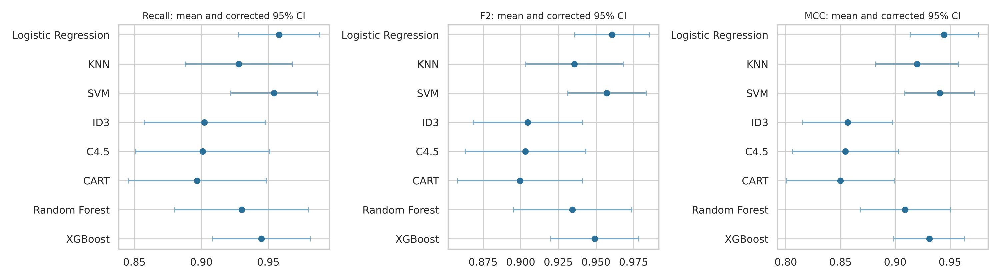

# Breast Cancer Detection Using Classical Machine Learning

Eight classical classifiers compared under identical conditions on the Wisconsin Diagnostic Breast Cancer (WDBC) dataset, with a focus on **not missing malignant cases**.

Models: **ID3** and **C4.5** (implemented from scratch), **CART**, **Random Forest**, **XGBoost**, **Logistic Regression**, **K-Nearest Neighbors** and **Support Vector Machine**.

## Key results

Repeated nested cross-validation: 5 folds x 10 repeats on all 569 samples, with **identical folds for every model** and hyperparameters tuned inside each fold. Values are means over the 50 outer test folds.

| Model | Accuracy | Recall | Specificity | F2 | MCC | ROC-AUC | Missed malignant (of 212) | False alarms (of 357) |
|---|---|---|---|---|---|---|---|---|
| **Logistic Regression** | **0.974** | **0.958** | **0.983** | **0.961** | **0.945** | **0.994** | **8.9** | **5.9** |
| SVM | 0.972 | 0.954 | 0.983 | 0.957 | 0.941 | 0.994 | 9.7 | 6.2 |
| XGBoost | 0.968 | 0.945 | 0.981 | 0.949 | 0.931 | 0.993 | 11.7 | 6.7 |
| KNN | 0.962 | 0.928 | 0.983 | 0.936 | 0.920 | 0.974 | 15.3 | 6.2 |
| Random Forest | 0.957 | 0.930 | 0.973 | 0.934 | 0.909 | 0.990 | 14.8 | 9.6 |
| ID3 | 0.933 | 0.902 | 0.951 | 0.905 | 0.857 | 0.944 | 20.7 | 17.6 |
| C4.5 | 0.931 | 0.901 | 0.950 | 0.903 | 0.854 | 0.939 | 21.0 | 18.0 |
| CART | 0.929 | 0.897 | 0.949 | 0.899 | 0.850 | 0.932 | 21.9 | 18.3 |

The last two columns count errors per pass, that is, when every sample is classified once.

- **Logistic Regression has the best mean on every headline metric**, but it is **statistically tied** with SVM and XGBoost (corrected t-test, Holm-adjusted p >= 0.90 on MCC).
- **The three single decision trees are significantly worse** on MCC, accuracy and ROC-AUC (p between 0.001 and 0.015), and miss more than twice as many cancers.
- A few small, smooth malignant masses are missed by every model in every repeat: they look benign in all 30 features.
- A single 80/20 split gives the same ordering but overstates the best model's recall (0.976 against 0.958).



## Method

| Step | What we did |
|---|---|
| Data | WDBC: 569 fine-needle aspirate samples (357 benign, 212 malignant), 30 nuclear features |
| Outer loop | `RepeatedStratifiedKFold`, 5 folds x 10 repeats, seed 42: every sample tested 10 times by every model |
| Inner loop | `GridSearchCV`, stratified 5-fold, model selected by **F2** (recall weighted 4x over precision) |
| Preprocessing | `StandardScaler` inside the pipeline for LR, KNN and SVM, fitted on training folds only (no leakage) |
| Metrics | Accuracy, balanced accuracy, precision, recall, specificity, F1, F2, MCC, ROC-AUC, PR-AUC, FN/FP counts |
| Statistics | Nadeau-Bengio corrected repeated k-fold t-test with Holm correction; mean ranks and a Friedman test |

ID3 bins each feature into quantiles and makes multiway splits on information gain. C4.5 uses binary thresholds chosen by gain ratio, with a vectorised threshold search. Both follow the scikit-learn estimator interface, so they run unchanged inside `GridSearchCV`.

## Quick start

```bash
pip install -r requirements.txt

python make_split.py              # shared stratified 80/20 split -> train_unscaled.csv, test_unscaled.csv
python eda.py                     # exploratory plots -> results/figures/eda_*.png
python compare_all_models.py      # single-split comparison of all 8 models -> results/
python nested_cv_comparison.py    # main comparison, about 30 min on 2 cores, resumes if interrupted
python analyse_nested_cv.py       # tables, significance tests and figures -> nested_results/
```

All random seeds are fixed at 42. Results were reproduced exactly with scikit-learn 1.8 and 1.9.1.

## Repository layout

| Path | Contents |
|---|---|
| `tree_models.py` | From-scratch `ID3Classifier` and `C45Classifier`, plus a standalone 5-tree comparison |
| `compare_all_models.py` | All 8 models on one shared 80/20 split, with error analysis and feature importance |
| `nested_cv_comparison.py` | Repeated nested cross-validation for all 8 models |
| `analyse_nested_cv.py` | Corrected t-tests, ranks, confidence intervals, hard samples and figures |
| `Logistic_Regression.ipynb` | Detailed Logistic Regression walkthrough, including threshold analysis |
| `knn_model.py`, `svm_model.py` | Early standalone KNN (from scratch) and SVM scripts on their own 70/20/10 split; not used for the reported results |
| `results/` | Single-split outputs |
| `nested_results/` | Nested cross-validation outputs: per-fold metrics, out-of-fold predictions, summaries |
| `report/` | Paper (Word and PDF) and presentation slides |

## Dataset

W. H. Wolberg, W. N. Street and O. L. Mangasarian, *Breast Cancer Wisconsin (Diagnostic)*, UCI Machine Learning Repository, https://archive.ics.uci.edu/dataset/17/breast+cancer+wisconsin+diagnostic (CC BY 4.0). `cleaned_data.csv` is that data with the ID column removed and the diagnosis coded 1 = malignant, 0 = benign.

## Authors

Udit Asthana, C. Nagesh Prabhu and Mahad Sheikh, Department of Computer Science and Engineering, Manipal Institute of Technology.

> This is an academic comparison on one public dataset without external clinical validation. It is not a diagnostic tool.
